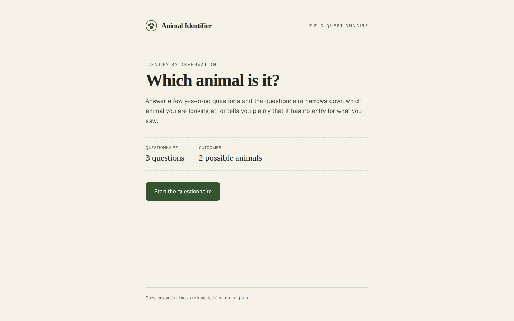
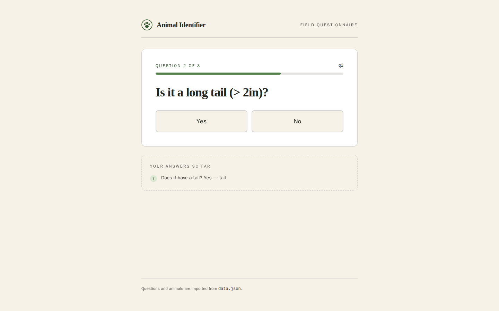
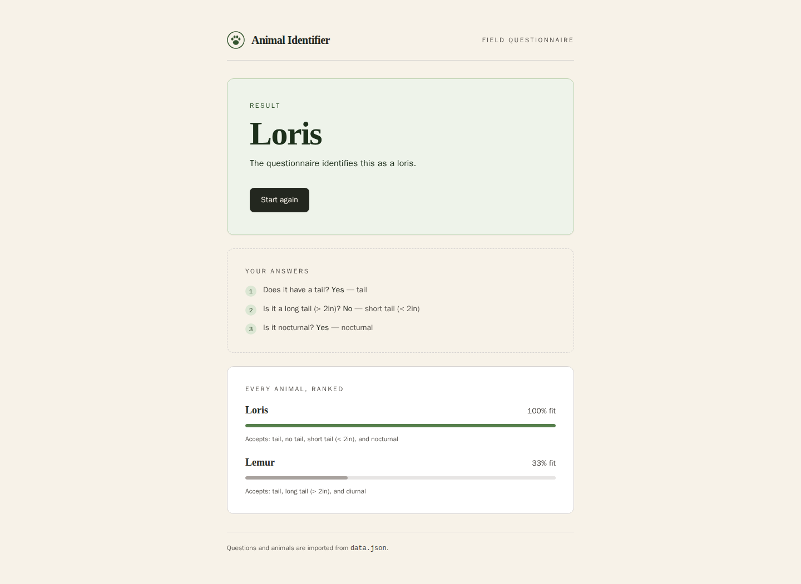
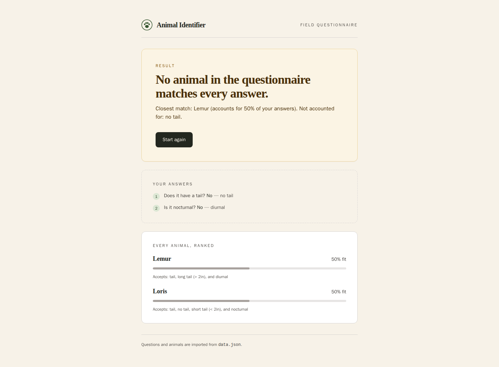
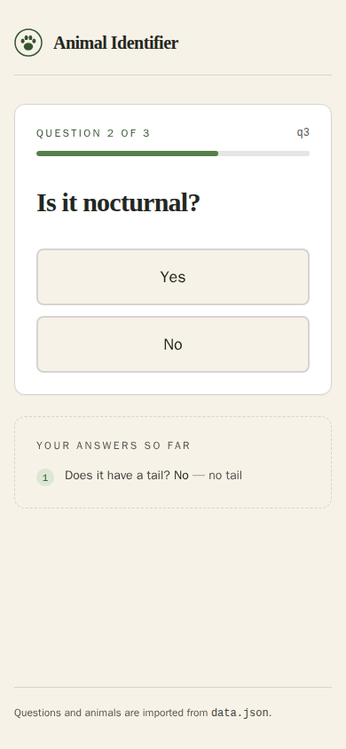
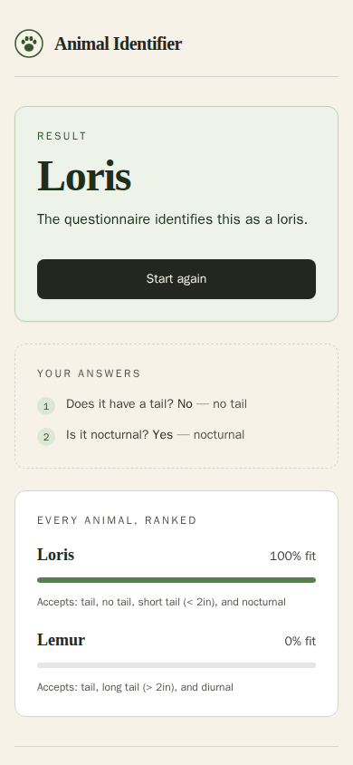
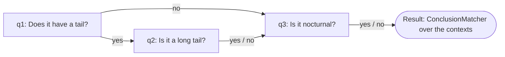
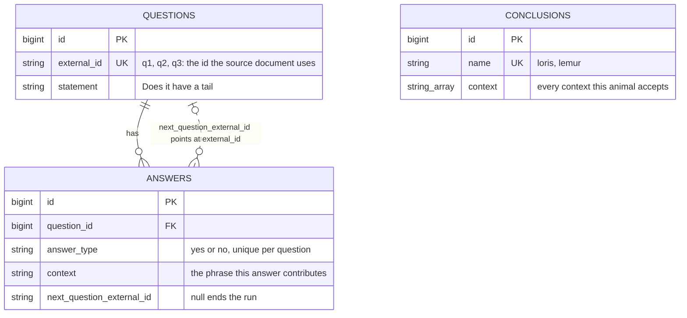

# Animal Identifier

Answer a short run of yes/no questions and this Rails app names the animal, or
says plainly that the questionnaire has no answer for the route you took. The
questions, the branches between them and the animals they lead to all live in
`data.json`. Nothing under `app/` knows what a tail is.

Underneath, it is a small decision-tree questionnaire engine: a JSON document
imported into PostgreSQL, a graph walked one question at a time, and a scorer
that decides which conclusion the collected answers point at.

## What a run looks like

| Start | Mid-questionnaire |
| --- | --- |
|  |  |

| A conclusion | No conclusion |
| --- | --- |
|  |  |

On a phone (390 px wide):

<p>
  
  
</p>

## Every route, and where it lands

The supplied questionnaire has three questions and two animals, which gives six
routes from the first question to a terminal answer. `bin/rails quiz:paths`
walks all of them (output kept in [`docs/quiz-paths.txt`](docs/quiz-paths.txt)):

```
tail + long tail (> 2in) + nocturnal             -> inconclusive (closest: lemur)
tail + long tail (> 2in) + diurnal               -> lemur
tail + short tail (< 2in) + nocturnal            -> loris
tail + short tail (< 2in) + diurnal              -> inconclusive (closest: lemur)
no tail + nocturnal                              -> loris
no tail + diurnal                                -> inconclusive (closest: lemur)
```

Half of the routes match nothing. That is a property of the data, not a
defect, and the application reports it rather than rounding to the nearest
animal.

## How a conclusion is chosen

Each answer contributes a **context**, a short phrase such as `no tail` or
`nocturnal`. Each conclusion carries the set of contexts it *accepts*; `loris`
accepts both `tail` and `no tail`, because lorises come both ways.

A conclusion is an exact match when every context the visitor produced is one it
accepts. The reverse is not required: the visitor need not have produced every
context the conclusion accepts. Three questions yield two or three contexts per
run, while `loris` accepts four, so demanding a full set would match nothing.

When nothing matches exactly, `Quiz::ConclusionMatcher` still ranks the
candidates and the result page shows the closest one, its score, and the
contexts it could not explain. Ranking is deterministic: highest score first,
then the more specific conclusion (the one accepting fewest contexts), then
name. The `50% / 50%` tie in the fourth screenshot is broken by that middle
rule: `lemur` accepts three contexts, `loris` four.

`app/services/quiz/conclusion_matcher.rb` is plain Ruby over three fields and is
tested against the complete truth table above, not a hand-picked path.

### Only whole runs are scored

Because `loris` accepts `no tail`, a single "no" to the first question is
already an exact match. Scoring a run that stopped half way would therefore
name an animal far too early. So:

- the result page only renders once the last answer is one that ends the run;
  otherwise it sends the visitor to their next question;
- a question can only be opened or answered if it is the first one, one the
  visitor has already answered (to change it), or the one their last answer
  leads to. A shared link to `?question=q3` takes a new visitor back to the
  start instead of skipping two questions.



Re-answering an earlier question discards the answers after it: in a decision
tree those later answers may no longer be reachable.

## The questionnaire is data

`data.json` is read by `Quiz::Sources::JsonFile`, turned into plain hashes, and
written into PostgreSQL by `Quiz::Importer`. Importing is a deploy-time step
(`bin/rails quiz:import`, also run by `db/seeds.rb` and the container
entrypoint), idempotent, and wrapped in one transaction: editing the source
updates rows in place, entries that have gone away are pruned, and a
questionnaire whose answers point at questions that do not exist is rejected
whole rather than half-applied.



Two things in that diagram are deliberate. The branch pointer is a *soft* link:
answers store the source document's own `external_id`, so an import can write
questions in any order and `Quiz::Graph` resolves the hops in memory after one
round trip. And `conclusions` has no foreign key to anything: a conclusion is
matched by its contexts, never by its position in the tree, which is why adding
an animal needs no schema change.

Swapping the source entirely is the other extension seam. `Quiz::Sources` is a
registry of adapters; a source is any object answering `#questions` and
`#conclusions`. Register a builder and point `QUESTIONNAIRE_SOURCE` at it to
load from an HTTP API or a CMS without touching the importer, the matcher or the
controller.

## Running it

### With Docker Compose

```bash
docker compose up --build
```

Then open <http://localhost:8661>. Compose starts Postgres 16 (published on
host port 8662) and the production image; the entrypoint runs `db:prepare` and
`quiz:import` on every start, and the container reports healthy once `GET /up`
answers:

```bash
$ curl -s http://localhost:8661/up
{"status":"ok","questions":3}
```

The Compose file uses a placeholder database password and a placeholder
`SECRET_KEY_BASE`. Both are fine on your own machine; set real values
(`bin/rails secret` generates a key) anywhere else.

### On your machine

Ruby 3.4 (`.ruby-version` pins 3.4.12), Node 22 with Yarn 1, and a reachable
PostgreSQL.

```bash
bundle install
yarn install
bin/rails db:prepare     # create + migrate; seeds run the import
bin/dev                  # Rails, esbuild --watch and tailwind --watch
```

Then open <http://localhost:3000>. After editing `data.json`, run
`bin/rails quiz:import` again; it is idempotent.

## Settings

Copy `.env.example` for a starting point. Nothing is required for local
development beyond a reachable PostgreSQL.

| Variable | Default | Purpose |
| --- | --- | --- |
| `DATABASE_URL` | none | Full connection string. Overrides everything below. |
| `DATABASE_NAME` | `doma_test_development` / `doma_test_production` | Database for the current environment. |
| `TEST_DATABASE_NAME` | `doma_test_test` | Database used by `bin/rails test`. |
| `DATABASE_HOST` / `DATABASE_PORT` | local socket / `5432` | Where PostgreSQL is. |
| `DATABASE_USERNAME` / `DATABASE_PASSWORD` | OS user / none | Role to connect as. |
| `RAILS_MAX_THREADS` | `5` | Puma threads and the Active Record pool size. |
| `RAILS_LOG_LEVEL` | `info` | Production log level (logs go to STDOUT). |
| `SECRET_KEY_BASE` | none | Required in production. There is no credentials file. |
| `QUESTIONNAIRE_SOURCE` | `json_file` | Which registered adapter to import from. |
| `QUESTIONNAIRE_PATH` | `data.json` | What to hand that adapter. |
| `SKIP_DB_PREPARE` | unset | Set to `1` to stop the container entrypoint migrating and importing. |

## Tests and checks

```bash
bin/rails test           # 83 runs, 0 failures (builds the JS/CSS bundles first)
bundle exec rubocop      # rubocop-rails-omakase, no offenses
bin/rails quiz:paths     # the truth table above
```

The suite imports the real `data.json` rather than fixtures, so a change to the
questionnaire that breaks the application breaks the tests. A transcript of a
run is in [`docs/test-run.txt`](docs/test-run.txt).

Two tests are worth pointing at:

- `test/integration/quiz_flow_test.rb` asserts that rendering a question issues
  exactly **two** queries, one for the questions and one for their answers, both
  preloaded by `Quiz::Graph`, so per-row querying cannot creep back in unnoticed.
- `test/integration/run_order_test.rb` covers the ways a partial run could
  otherwise be scored: the result page mid-run, deep links ahead of the next
  question, and answers posted to a question that has not been reached.

## Reading the code

The controller only routes. Everything that decides anything is in
`app/services/quiz/`:

| File | Responsibility |
| --- | --- |
| `sources.rb` | Adapter registry, the extension seam |
| `sources/json_file.rb` | Reads and validates the JSON document |
| `importer.rb` | Transactional, idempotent import and reconciliation |
| `graph.rb` | Traversal: root, depth, every route, cycle detection |
| `conclusion_matcher.rb` | Scoring and ranking, the domain rule |
| `progress.rb` | One visitor's run, backed by the session |

`Quiz::Progress` keeps JSON-safe hashes because the session is serialised as
JSON, and records where each answer leads so the controller can tell a finished
run from an unfinished one.

The pages load nothing from other origins and use no inline styles or scripts,
so `config/initializers/content_security_policy.rb` can be strict
(`default-src 'self'`, no `unsafe-inline`). The progress bars are native
`<progress>` elements for the same reason.

## Out of scope

- One imported questionnaire at a time: no multi-tenancy, no versioning.
- Progress lives in the session cookie, so a run cannot be resumed on another
  device and does not survive clearing cookies.
- Questionnaire text comes from the source document as written. UI text is in
  `config/locales/en.yml`, but there is no translation layer for the questions
  themselves.
- Contexts are opaque strings. The matcher has no notion of one context
  contradicting another beyond "this conclusion does not accept it".
- No authentication, rate limiting or analytics.

## License

MIT. See [LICENSE](LICENSE).
